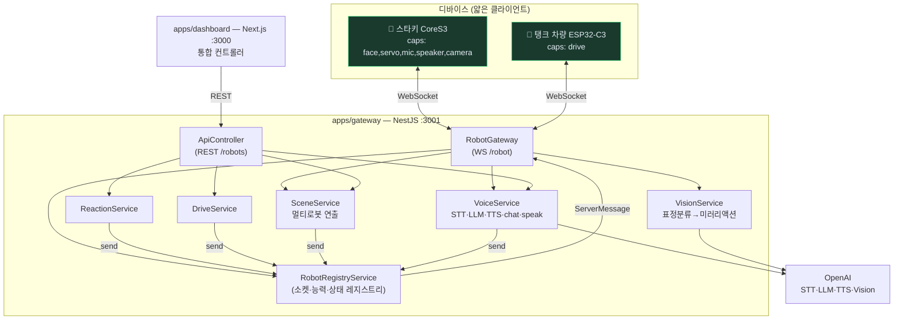
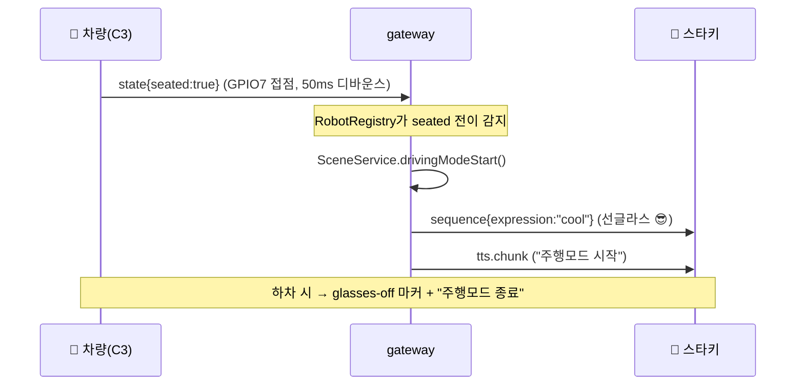

# 스낵 익스프레스 — 조종실 (Cockpit Server)

M5Stack CoreS3 스타크챤 로봇의 두뇌를 서버로 옮긴 씬 클라이언트 아키텍처.
로봇은 판단하지 않는다 — 표정·서보·센서 입출력만 하고, 모든 판단은 이 서버가 한다.

```
[스타키 CoreS3] ─┐                      ┌─→ [dashboard: Next.js :3000]
[탱크 차량 C3]  ─┴─WebSocket→ [gateway: NestJS :3001] ─REST─┘
                                    │
                                 OpenAI (STT·LLM·TTS·Vision)
```

두 로봇(얼굴 담당 스타키 + 주행 담당 차량)이 같은 서버에 붙고, 대시보드의 통합
컨트롤러가 능력(capabilities)에 따라 명령을 자동 분배한다. 착좌 → 주행모드 선글라스,
클락션 같은 멀티 로봇 연출은 `apps/gateway`의 SceneService가 조율한다.

## 리포 구성 (세트)

이 프로젝트는 두 리포로 나뉜다:

| 리포 | 내용 |
|---|---|
| **jiyeonLeeLuda/ai-rc-bot** (이 리포) | 조종실 서버·대시보드·프로토콜 + 차량(ESP32-C3) 펌웨어(`firmware/vehicle`) |
| [**jiyeonLeeLuda/AI_StackChan_Ex**](https://github.com/jiyeonLeeLuda/AI_StackChan_Ex/tree/feature/cockpit-ws) `feature/cockpit-ws` | 스타키(CoreS3) 로봇 펌웨어 — WS 클라이언트, 미러모드, 선글라스/EyeFX 연출. ronron-gh 원본(MIT) 포크 |

제작 가이드(부품 구매~첫 주행, 공유용): [`docs/build-guide-share.pdf`](docs/build-guide-share.pdf)

## 패키지

| 경로 | 이름 | 역할 |
|---|---|---|
| `packages/protocol` | `@snack-express/protocol` | 로봇↔서버 메시지 스키마(zod) — **계약의 정본** |
| `apps/gateway` | `@snack-express/gateway` | NestJS. 로봇 WS 접속(`:3001/robot`), 음성 파이프라인, 리액션·씬 하달, 드라이브 중계 |
| `apps/dashboard` | `@snack-express/dashboard` | Next.js(`:3000`). 연결 기기 모니터 + 통합 컨트롤러(능력 기반 라우팅) |
| `firmware/vehicle` | — | 탱크 차량 ESP32-C3 펌웨어(PlatformIO). drive·착좌 감지·모터 비프·멀티 네트워크 |
| `tools/mock-robot` | `@snack-express/mock-robot` | 하드웨어 없이 개발하기 위한 가짜 로봇 CLI |

## 시작하기

```bash
nvm use            # Node 22
pnpm install
pnpm build

pnpm dev:gateway   # 터미널 1 — :3001
pnpm mock-robot    # 터미널 2 — 가짜 로봇 접속
pnpm dev:dashboard # 터미널 3 — :3000
```

대시보드에서 mock-stacky가 보이면 리액션 버튼으로 sequence 명령이
mock-robot 터미널에 재생되는 것까지가 end-to-end 확인.

## 설계 원칙

- **데이터화된 리액션**: 리액션은 코드가 아니라 데이터(`sequence` 스텝 배열). 로봇 펌웨어 수정 없이 서버에서 리액션 추가.
- **데드맨 스위치**: 모든 drive 명령은 `ttlMs` 필수. 서버·Wi-Fi가 죽어도 차량은 ttl 만료 시 정지.
- **mock-robot 우선**: 실물 펌웨어를 고치기 전에 모의 클라이언트로 서버를 완성한다.

프로젝트 전체 브리프(하드웨어·로드맵·배선)는 `CLAUDE.md` 참고.

---

# 소프트웨어 설계 문서 (SDD)

## 1. 개요

스낵 익스프레스는 **얼굴 로봇(스타키)**과 **탱크 차량**이 한 서버에 붙어 함께 연출되는
멀티 로봇 시스템이다. 핵심 설계 결정은 **"로봇은 판단하지 않는다"** — 로봇은 표정·서보·
센서 입출력만 수행하고, 모든 지능과 조율은 조종실 서버가 담당한다. 이로써 로봇 펌웨어를
다시 굽지 않고도 서버 배포만으로 행동을 바꿀 수 있다.

### 설계 결정 (ADR 요약)

| # | 결정 | 이유 |
|---|---|---|
| 1 | 씬 클라이언트 (서버가 판단) | 펌웨어 재빌드 없이 행동 변경, 로봇은 얇게 유지 |
| 2 | 데이터화된 리액션 (`sequence` 스텝 배열) | 리액션 = 코드가 아닌 데이터. 서버에서만 추가 |
| 3 | 능력(capabilities) 기반 라우팅 | 로봇 종류를 하드코딩하지 않고 능력으로 명령 분배 |
| 4 | 데드맨 스위치 (`ttlMs` 필수) | 서버·Wi-Fi 장애 시 차량 폭주 방지 |
| 5 | mock-robot 우선 | 실물 없이 서버를 end-to-end 완성 |

## 2. 시스템 구조



**데이터 흐름**: 디바이스는 WS로 `hello`(신원+능력)를 보내 레지스트리에 등록된다.
대시보드는 REST로 명령을 치고, 각 서비스는 레지스트리의 `send(robotId, msg)`로
해당 로봇에 `ServerMessage`를 하달한다. 능력에 맞지 않는 명령(예: 차량에 `face`)은
서비스 단에서 거부되거나 라우팅 단에서 걸러진다.

## 3. 프로토콜 (`packages/protocol` — 계약의 정본)

모든 메시지는 zod 스키마로 검증되는 JSON WS 프레임. 능력 7종:
`face · servo · mic · speaker · camera · led · drive`.

| 방향 | 메시지 | 용도 |
|---|---|---|
| 로봇→서버 | `hello` | 신원·펌웨어·**capabilities** 등록 |
| | `state` | mode·batteryPct·**seated**(착좌) 주기 보고 |
| | `audio.chunk` | 마이크 PCM 스트림 (16kHz) |
| | `camera.frame` | 미러모드 카메라 프레임 (JPEG) |
| | `touch` | 터치 존 이벤트 |
| 서버→로봇 | `hello.ack` | 세션 확립 |
| | `sequence` | **리액션 재생** — 스텝 배열(표정·서보·led·**sound**·text·durationMs) |
| | `tts.chunk` | TTS/효과음 PCM 스트림 (24kHz) |
| | `listen` | 마이크 턴 제어 |
| | `drive` | 좌/우 트랙 출력 + **ttlMs**(데드맨) |

`sequence`의 `sound` 필드는 효과음 겸 **제어 마커**로 재활용된다
(`horn`=클락션, `glasses-off`=선글라스 해제, `eyes-ok/no/big/small`=눈 이펙트).

## 4. 주요 시퀀스

### 4-1. 착좌 → 주행모드 연출 (멀티 로봇)



### 4-2. drive 데드맨 스위치

대시보드는 버튼을 누르는 동안 150ms 간격으로 `drive{ttlMs:300}`을 반복 전송한다.
차량은 마지막 명령 후 300ms 내에 다음 명령이 없으면 **자동 정지**한다 — WS가 끊겨도
폭주하지 않는다. `ttlMs`는 프로토콜에서 필수(50~2000ms).

### 4-3. 음성 대화 / 말 걸기

마이크 발화(`audio.chunk`) 또는 대시보드 "말 걸기"(`POST /chat`) → VoiceService가
STT·LLM·TTS를 돌려 `tts.chunk`(음성) + `sequence`(감정 표정)를 하달. 두 입력이 **대화
이력을 공유**해 음성↔텍스트를 오가도 맥락이 유지된다. 말풍선은 TTS 합성 완료 후 음성과
동시에 표시(엇박자 방지).

## 5. 상태 관리

`RobotRegistryService`가 단일 진실 원천: 소켓↔robotId 매핑, 능력, 최신 `state`(mode·
seated·battery)를 보유한다. `findByCapability('face')` 같은 조회로 씬이 대상 로봇을 찾고,
`updateState`가 seated 전이(이전값 비교)를 반환해 연출 트리거를 판단한다.

## 6. 디렉토리 구조

```
ai-rc-bot/
├─ packages/protocol/      # zod 메시지 스키마 (계약 정본)
├─ apps/
│  ├─ gateway/src/
│  │  ├─ robot/            # RobotGateway(WS) + RobotRegistryService
│  │  ├─ voice/            # STT·LLM·TTS·chat·speak
│  │  ├─ vision/           # 미러모드 표정분류
│  │  ├─ reaction/         # 리액션 테이블(데이터) + 전송
│  │  ├─ drive/            # drive 중계 (능력 가드)
│  │  ├─ scene/            # 멀티로봇 연출(착좌·클락션)
│  │  └─ api/              # REST 컨트롤러
│  └─ dashboard/src/       # 통합 컨트롤러 UI
├─ firmware/vehicle/       # 탱크 차량 C3 펌웨어(PlatformIO)
└─ tools/mock-robot/       # 하드웨어 없는 가짜 로봇 CLI
```

스타키(CoreS3) 펌웨어는 [별도 포크 리포](https://github.com/jiyeonLeeLuda/AI_StackChan_Ex/tree/feature/cockpit-ws)
의 `feature/cockpit-ws` 브랜치 — `src/cockpit/SequencePlayer`가 `sequence`를 재생하고,
`src/mod/AiStackChan/`의 CoolGlasses·EyeFX가 선글라스·눈 연출을 렌더한다.
